# API Flow Diagrams

Developer reference — sequence and flow diagrams for all core APIs.

---

## 1. User Create Without Initial Role

> **API:** `POST /api/admin/users`
> **Precondition:** User does not exist. Admin provides `username` and `password` only.
> Role is assigned separately after creation.

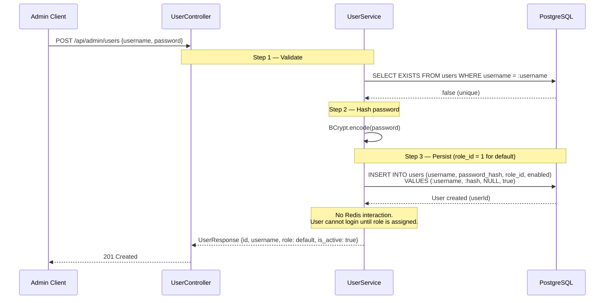
---

## 2. User Role Assign and Allow/Deny Permission

> **API:** `PUT /api/admin/users/{userId}/role` — assign role to user who has none
> **API:** `PUT /api/admin/users/{userId}/permissions` — assign allow/deny overrides
> **Precondition:** User was created without a role (Flow 1). Admin now assigns role and optionally sets allow/deny permissions.

### 2a. First-Time Role Assignment

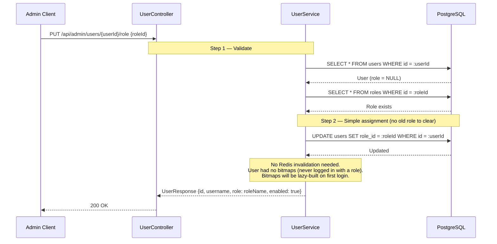

### 2b. Allow/Deny Permission Assignment

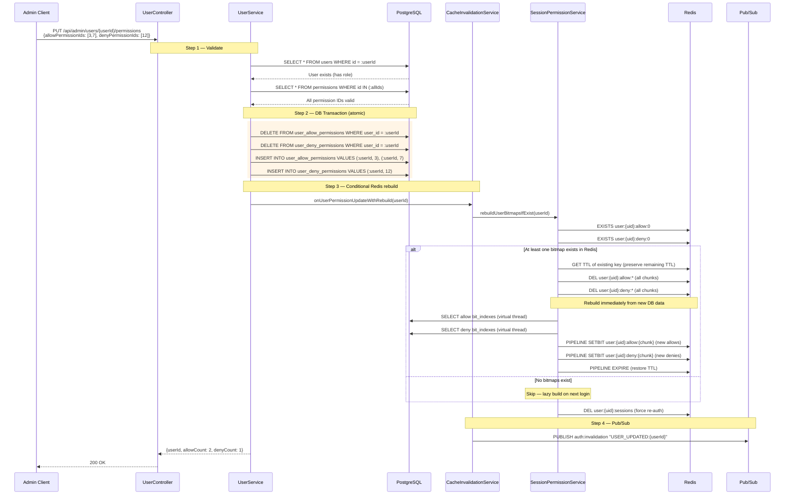
---

## 3. User Role Change and Allow/Deny Permission Update

> **API:** `PUT /api/admin/users/{userId}/role`
> **Precondition:** User already has a role assigned. Admin changes to a different role.
> **Effect:** Changes role. Clears ALL user-level allow/deny permissions
> (they were granted relative to the old role and are no longer valid).

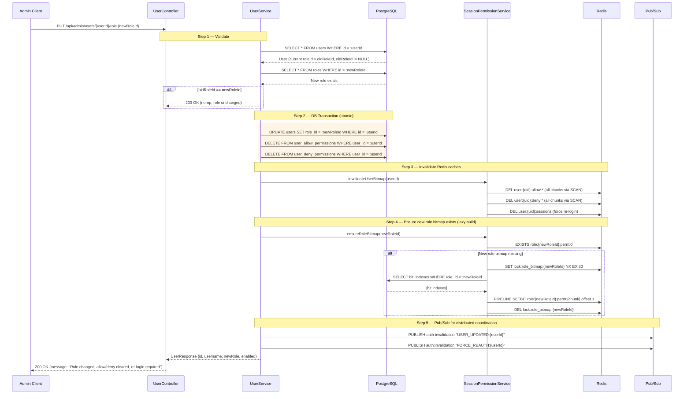

---

## 5. User Allow/Deny Permission Change (Recompute Bitmap If Exists)

> **API:** `PUT /api/admin/users/{userId}/permissions`
> **Effect:** Replaces the user's allow and/or deny permission overrides.
> If bitmaps exist in Redis, they are deleted and rebuilt immediately (not deferred to login).

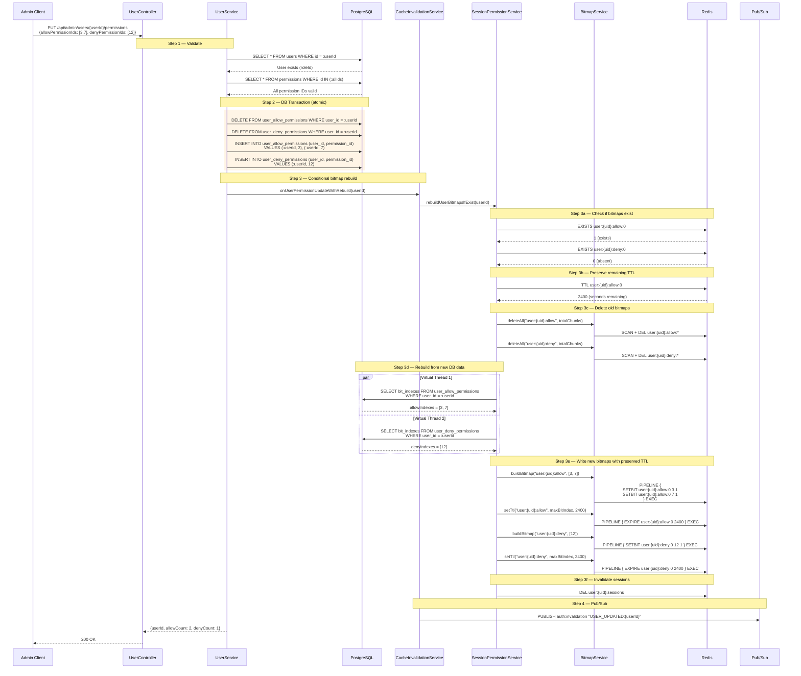
---

## 6. Role Permission Assignment (Add, Remove, In-Place Bitmap Update)

> **APIs:**
> - `POST /api/admin/roles/{roleId}/permissions` — Add individual permissions to a role
> - `DELETE /api/admin/roles/{roleId}/permissions` — Remove individual permissions from a role
> - `PUT /api/admin/roles/{roleId}/permissions` — Full replace (existing, unchanged)
>
> **Key detail:** If the role bitmap exists in Redis, individual add/remove updates it in-place
> via `SETBIT` (1 for add, 0 for remove) instead of full invalidation + lazy rebuild.

### 6a. Add Permissions to Role (In-Place Bitmap Update)

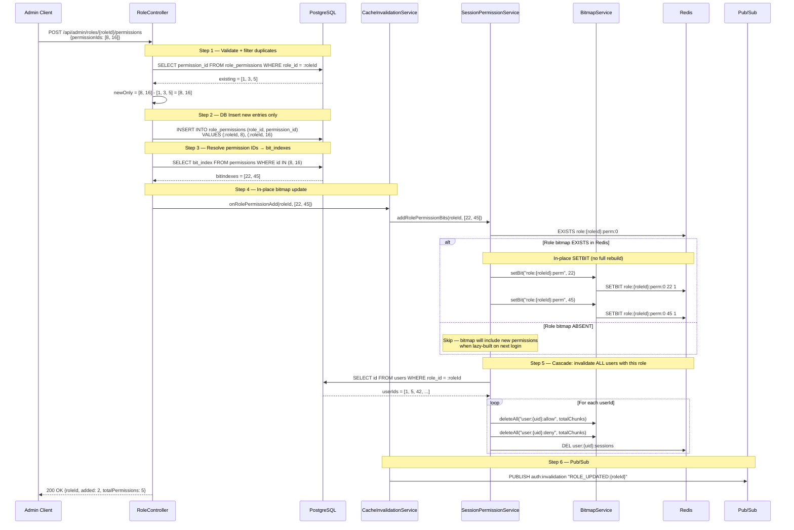

### 6b. Remove Permissions from Role (In-Place Bitmap Clear)

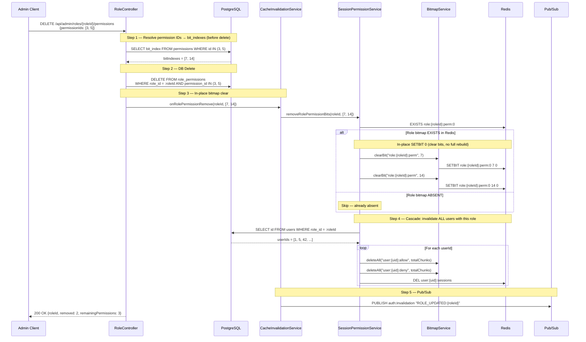

### 6c. Full Replace (Existing — Unchanged)

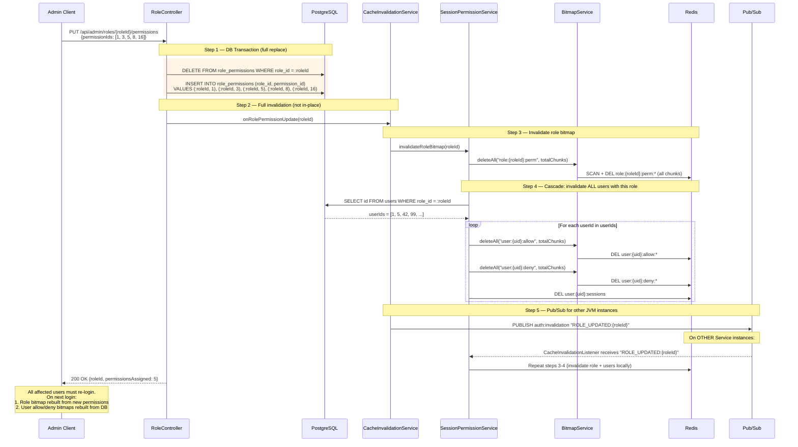

---

### 7b. AuthService Authorization Check (Fallback/Testing)

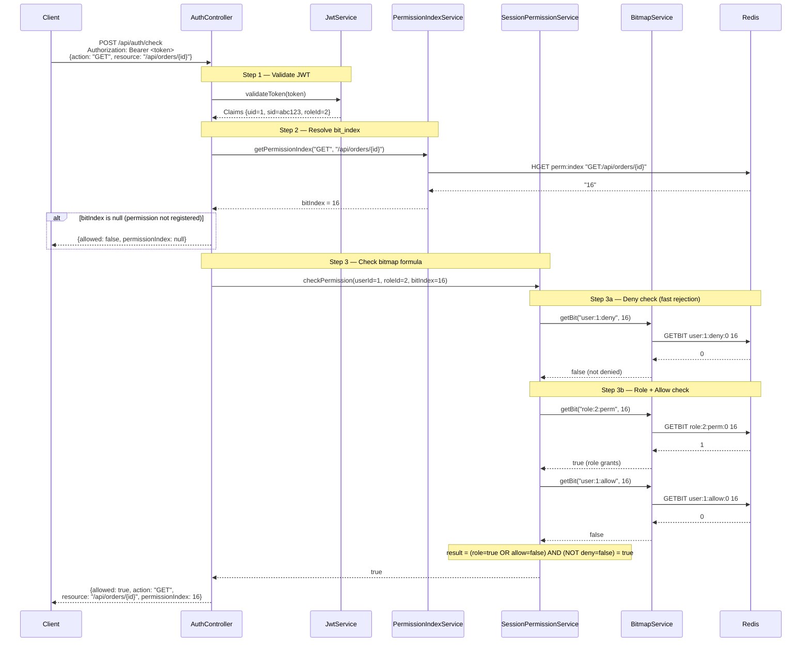

---

## 8. Module, Feature & Capability Management

> These APIs, entities, and the capability resolution flow do not exist in the codebase.
> Diagrams below are design references. See [Entity Relationships](entity_relationships.md#2-presentation-layer-planned).

> **APIs:** `/api/admin/modules`, `/api/admin/features`, `/api/admin/capabilities`
> **Purpose:** Manage the presentation layer — modules organize features, features group
> capabilities, capabilities map business actions to HTTP-level permissions.
> **Hierarchy:** Module → ModuleFeature → Capability → Permission

### 8a. Capability → Permission Mapping

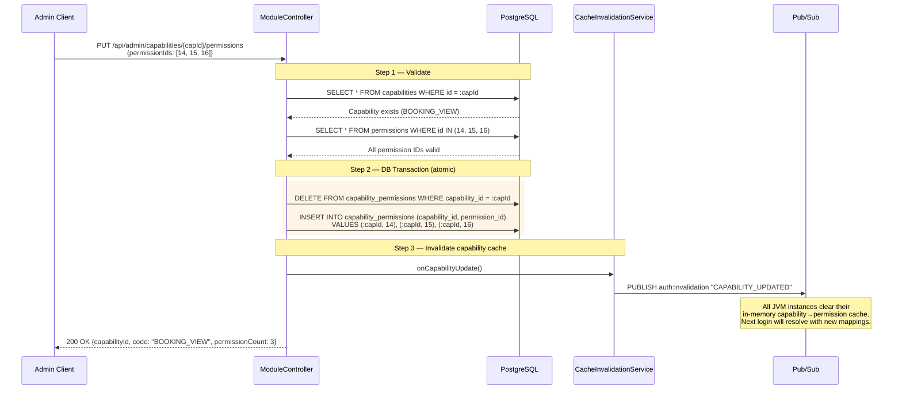

### 8b. Capability Resolution at Login (Detail)

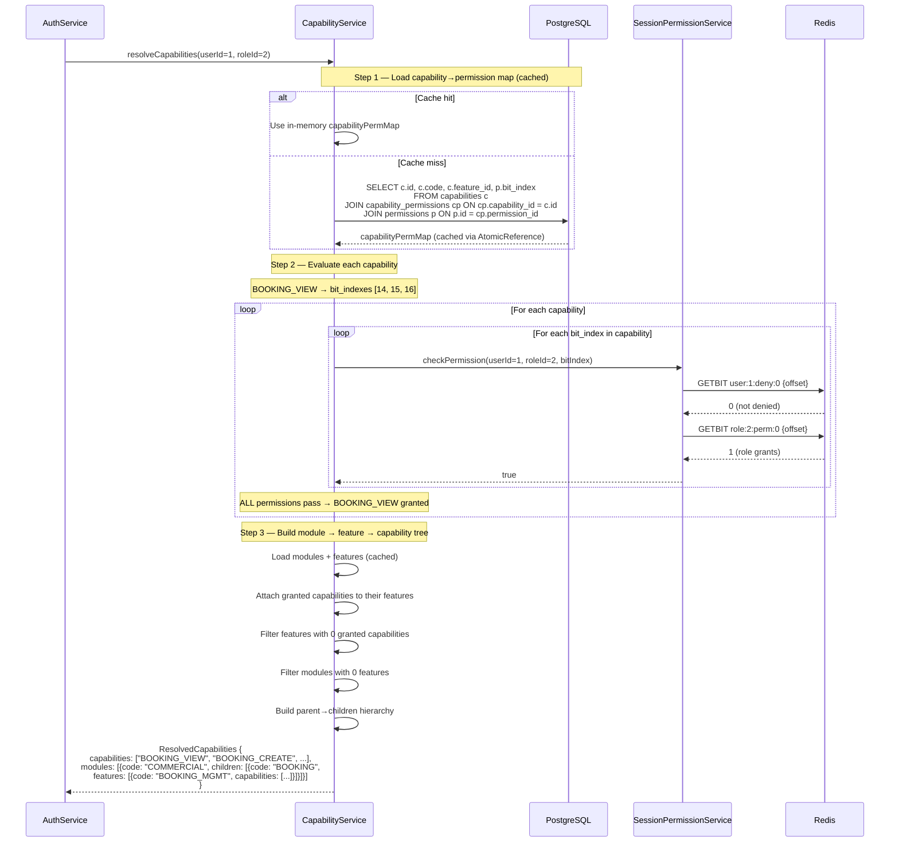

---

## Redis Pipeline Usage Summary

| API Flow | Pipeline Operations | Round-trips |
|---|---|---|
| Login -- role bitmap build | `SETBIT * N` (all role permissions) | 1 pipeline |
| Login -- allow bitmap build | `SETBIT * N` (allow indexes) | 1 pipeline |
| Login -- deny bitmap build | `SETBIT * N` (deny indexes) | 1 pipeline |
| Login -- allow TTL set | `EXPIRE * chunks` | 1 pipeline |
| Login -- deny TTL set | `EXPIRE * chunks` | 1 pipeline |
| Login -- TTL extend | `EXPIRE * chunks` (allow + deny) | 1 pipeline |
| Login -- capability resolution | 3x `GETBIT` per permission per capability | Pipelineable *(planned)* |
| Auth check (APISIX) | `EVAL` (3x GETBIT inside Lua) | 1 round-trip |
| Auth check (Spring) | 3x `GETBIT` (deny, role, allow) | 3 round-trips |
| Role perm add (in-place) | `EXISTS` + `SETBIT * N` (1 per new perm) | 1 + N round-trips |
| Role perm remove (in-place) | `EXISTS` + `SETBIT * N` (0 per removed perm) | 1 + N round-trips |
| Role perm full replace | `SCAN + DEL` (full invalidation) | 1+ per prefix |
| User perm change (rebuild) | `EXISTS` + `TTL` + `SCAN + DEL` + `SETBIT * N` + `EXPIRE` | 3+ pipelines |
| User perm change (lazy) | None (bitmaps absent) | 0 |
| Invalidation | `SCAN + DEL` per prefix | 1+ per prefix |
