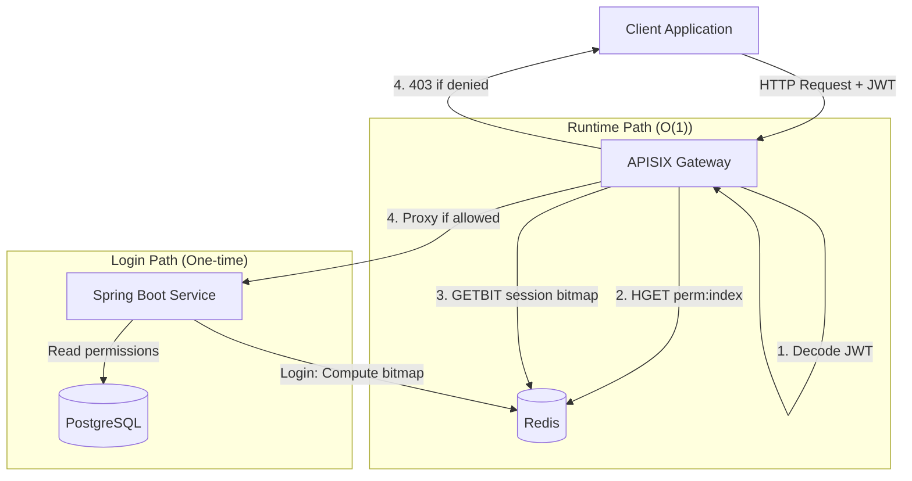
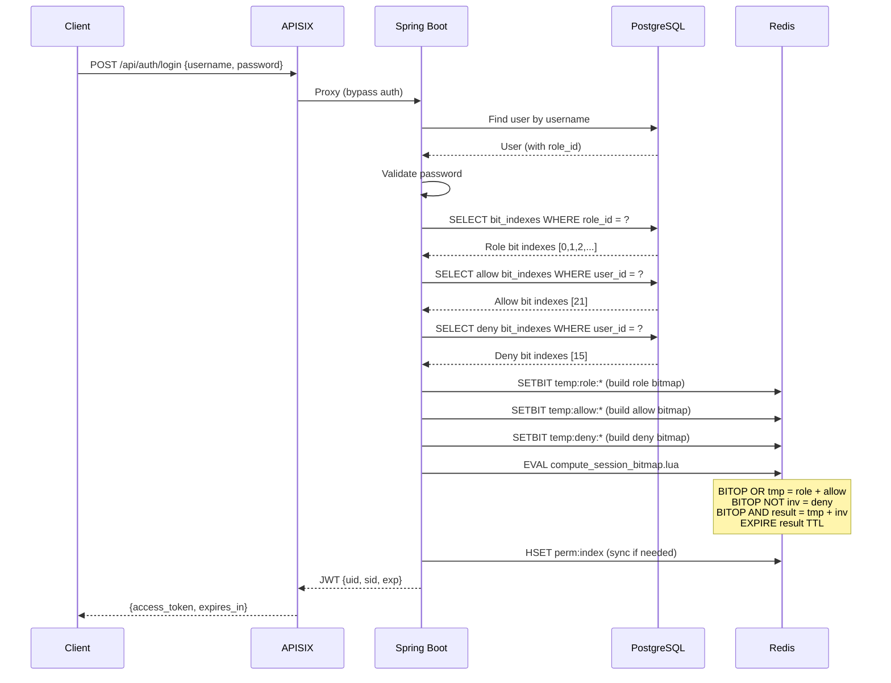
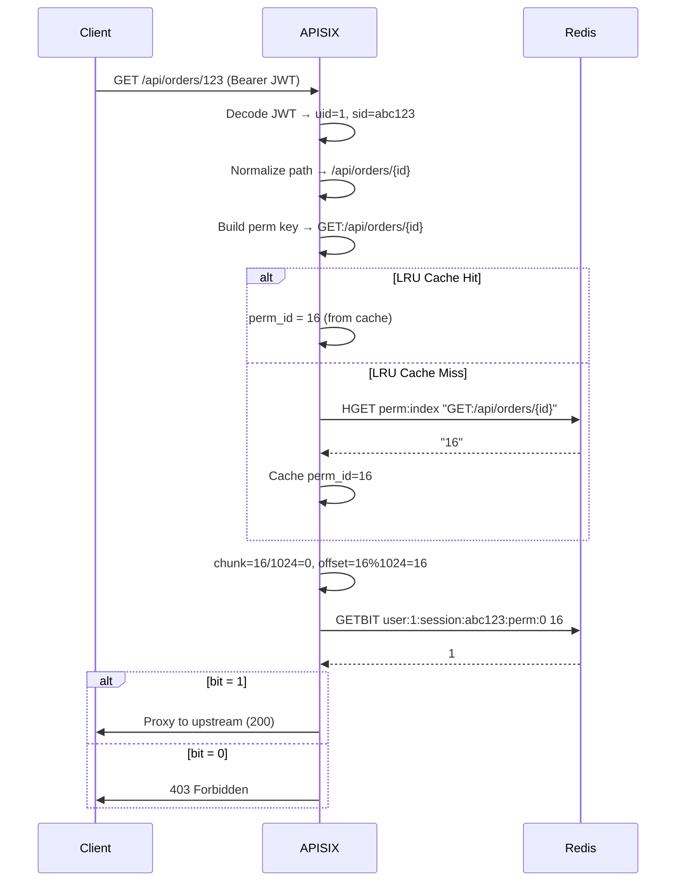
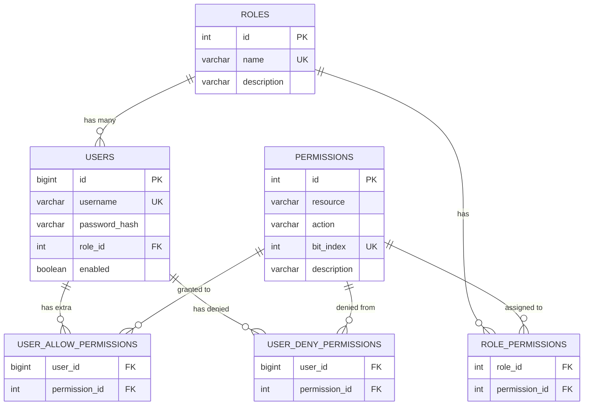

# System Architecture

## High-Level Architecture



## Login Flow Sequence



## Authorization Check Flow



## Data Model



## Bitmap Computation

```
Permission Formula:  final = (role_perm OR allow_perm) AND (NOT deny_perm)

Example (staff1, bit positions 0-7):

Role (STAFF):     1 0 1 0 0 0 1 0    (bits 0, 2, 6 set)
Allow (user):     0 0 0 0 0 1 0 0    (bit 5 = extra perm)
Deny  (user):     0 0 0 0 0 0 0 0    (no denials)

Step 1 - OR:      1 0 1 0 0 1 1 0    (role + allow)
Step 2 - NOT:     1 1 1 1 1 1 1 1    (not deny = all 1s)
Step 3 - AND:     1 0 1 0 0 1 1 0    (final permissions)
```
