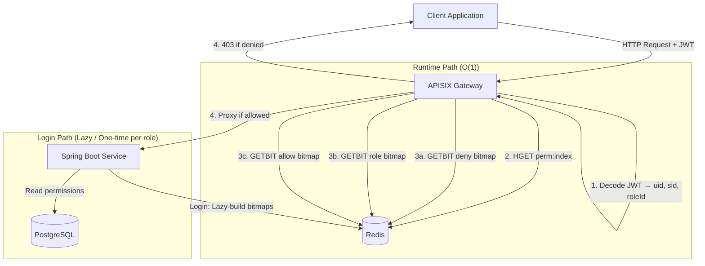
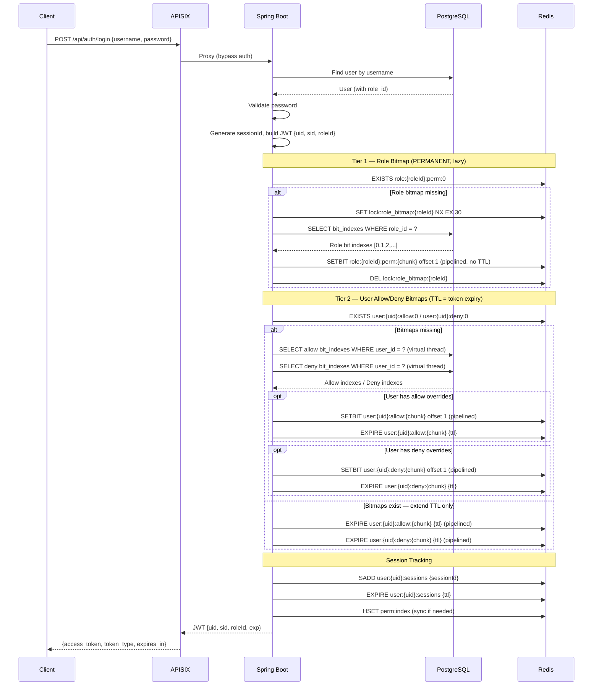
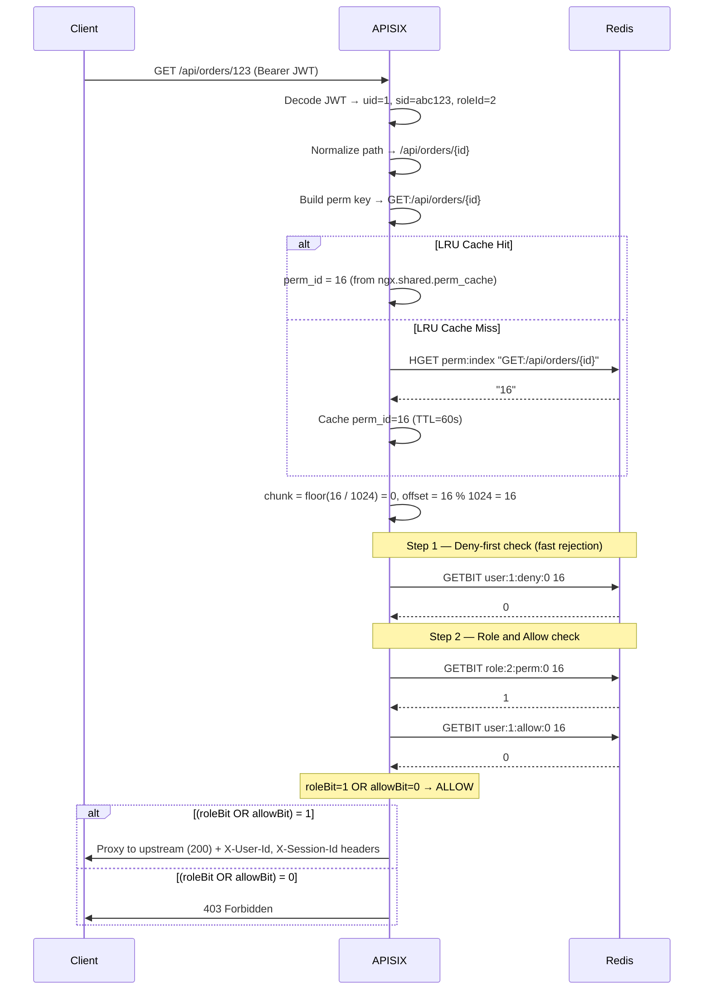
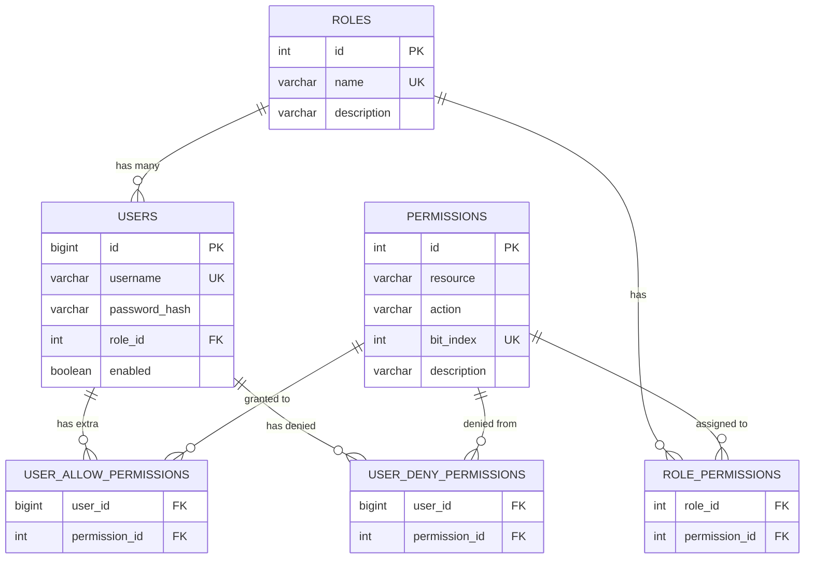

# System Architecture

## High-Level Architecture



## Login Flow Sequence



## Authorization Check Flow



## Data Model



## Redis Key Patterns

| Key Pattern                        | Type          | TTL              | Description                                       |
|------------------------------------|---------------|------------------|---------------------------------------------------|
| `perm:index`                       | HASH          | None (permanent) | Maps `METHOD:path` → permission `bit_index`       |
| `role:{roleId}:perm:{chunk}`       | Binary STRING | None (permanent) | Role permission bitmap, chunk N (1024 bits each)  |
| `user:{uid}:allow:{chunk}`         | Binary STRING | Token expiry     | User extra-grant bitmap; created only if needed   |
| `user:{uid}:deny:{chunk}`          | Binary STRING | Token expiry     | User deny bitmap; created only if needed          |
| `user:{uid}:sessions`              | SET           | Token expiry     | Active session IDs for this user                  |
| `lock:role_bitmap:{roleId}`        | STRING        | 30 s             | Distributed build lock; prevents thundering herd  |

### Chunk Sizing

Bitmaps are split into chunks of `app.bitmap.chunk-size` bits (default: 1024).
A permission with `bit_index = N` maps to:
- key:    `{prefix}:{floor(N / 1024)}`
- offset: `N % 1024`

With 40 permissions (indexes 0–39) all bits fit in chunk 0. With 2000 permissions, chunks 0 and 1 are used.

### Cache Invalidation

Coordinated via Redis Pub/Sub on channel `auth:invalidation`:

| Event                    | Pub/Sub Message          | Effect                                                    |
|--------------------------|--------------------------|-----------------------------------------------------------|
| Role permissions changed | `ROLE_UPDATED:{roleId}`  | Delete `role:{roleId}:perm:*`; invalidate affected users  |
| User override changed    | `USER_UPDATED:{uid}`     | Delete `user:{uid}:allow:*`, `user:{uid}:deny:*`, sessions|
| Permission added/removed | `PERM_INDEX_REFRESHED`   | Atomically re-sync `perm:index` from DB                   |
| Force re-auth            | `FORCE_REAUTH:{uid}`     | Delete user bitmaps + sessions; forces re-login           |

## Bitmap Computation

```
Permission Formula:  (role_perm OR allow_perm) AND (NOT deny_perm)
```

The formula is evaluated at **request time** by the APISIX plugin via three sequential `GETBIT` calls.
No BITOP precomputation occurs at login — bitmaps are written (`SETBIT`) at login and read at every request.

### Evaluation Order (per request, in APISIX)

```
Step 1 — Deny check (fast rejection):
  GETBIT user:{uid}:deny:{chunk} {offset}
  → If 1: return 403 immediately

Step 2 — Role and allow check:
  GETBIT role:{roleId}:perm:{chunk} {offset}   → roleBit
  GETBIT user:{uid}:allow:{chunk} {offset}      → allowBit
  → If (roleBit OR allowBit) = 1: 200 OK
  → Else: 403 Forbidden
```

### Example (uid=1, roleId=2, bit positions 0–7)

```
Role (roleId=2):  1 0 1 0 0 0 1 0    (bits 0,2,6 — PERMANENT, shared by all users in role)
Allow (uid=1):    0 0 0 0 0 1 0 0    (bit 5 = extra grant — TTL-scoped, user-specific)
Deny  (uid=1):    0 0 0 0 0 0 0 0    (no denials — key absent, GETBIT returns 0)

For bit 5 (extra resource):
  deny=0 → not rejected
  role=0 → role does not grant this
  allow=1 → user-specific grant applies
  Result: ALLOW

For bit 3 (admin-only resource):
  deny=0 → not rejected
  role=0 → role does not grant this
  allow=0 → no user-specific grant
  Result: DENY (403)
```

### Optimization Notes

- **Role bitmaps are permanent.** Built once per role on first login (under a 30 s distributed lock).
  Invalidated only when role-permission mappings change via the admin API.
- **Allow/deny bitmaps are conditional.** Only created when the user has overrides in the DB.
  Users with no overrides have no allow/deny keys; `GETBIT` on a missing key returns 0 by Redis spec.
- **TTL is extended on each login** to equal the new token expiry — no bitmap rebuild needed for returning users.
- **Deny-first** short-circuits evaluation: a denied user never hits the role/allow checks.
