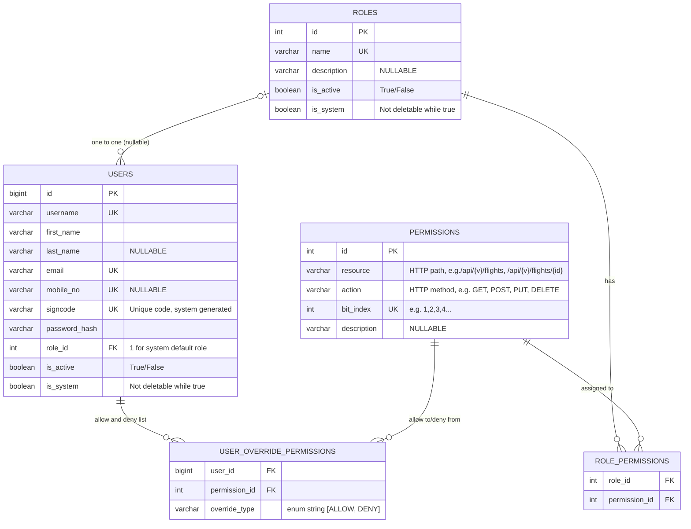
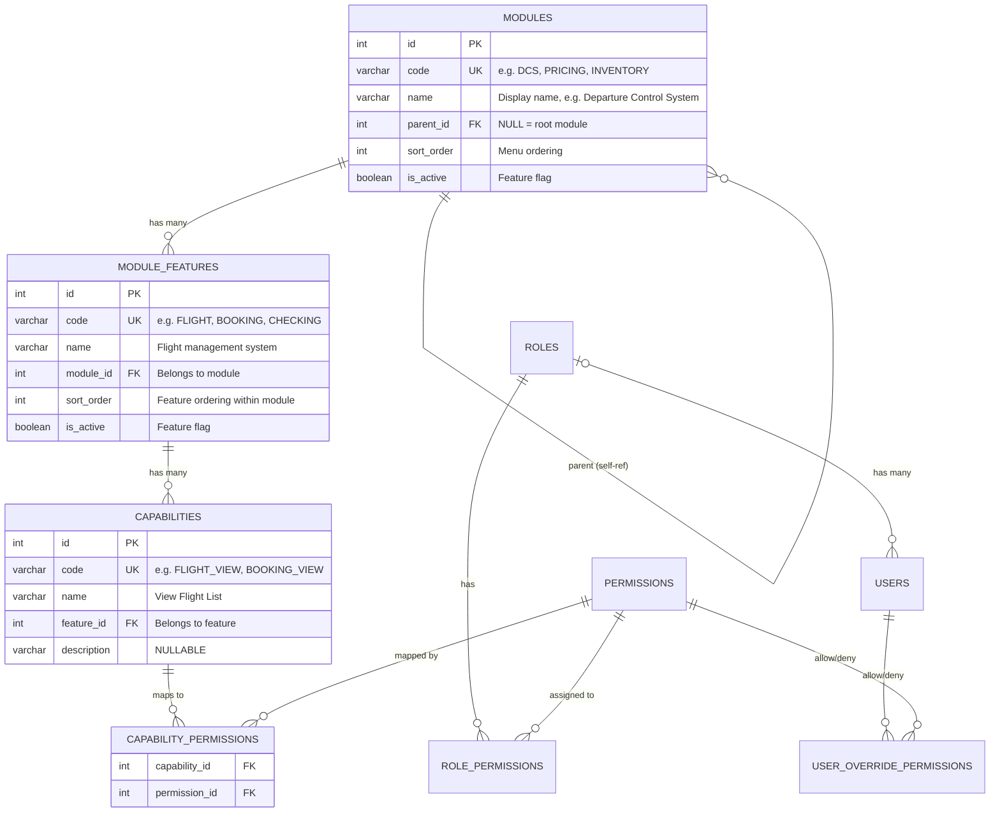

# Entity Relationships & Data Model

This document is the **single source of truth** for all entity relationships in the auth system.

- **Section 1** — Enforcement Layer: the bitmap RBAC system (implemented, enforced at gateway)
- **Section 2** — Presentation Layer: modules, features, capabilities for frontend UI (planned)

---

## 1. Enforcement Layer (Implemented)

The bitmap permission system is the **security boundary**. It is enforced at every HTTP request
by the APISIX plugin (`bitmap-auth.lua`) and backed by Redis bitmaps built at login time.

### ER Diagram



### Permission Formula

```
result = (role OR allow) AND (NOT deny)
```

- **Role permissions** — shared by all users in the role, stored as permanent Redis bitmaps
- **Allow overrides** — per-user extra grants beyond the role, TTL-scoped
- **Deny overrides** — per-user revocations from the role, TTL-scoped (deny always wins)

Users can exist without a role (`role_id = NULL`). Login is rejected with 403 until a role is assigned.

---

## 2. Presentation Layer (Planned)

### Overview

Three entities add a **business-level abstraction** on top of the existing bitmap permission system:

- **Module** -- top-level organizational grouping (hierarchical, self-referencing parent)
- **ModuleFeature** -- functional area within a module
- **Capability** -- business action within a feature, maps to one or more HTTP-level permissions

The bitmap layer (permissions with `bit_index`) remains the **enforcement mechanism** at the gateway/backend.
Capabilities are the **frontend-facing contract** -- stable business identifiers that decouple the UI from HTTP routes.

```
┌──────────────────────────────────────────────────────────────┐
│                    Frontend (Next.js)                         │
│                                                              │
│  Uses: modules -> features -> capabilities                   │
│        for menu structure, route guards, component visibility │
│  Never sees: bit_indexes, HTTP paths, bitmap keys            │
└───────────────────────────┬──────────────────────────────────┘
                            │ modules[features[capabilities[]]]
                            │ (returned at login)
┌───────────────────────────▼──────────────────────────────────┐
│              Presentation Layer (PLANNED)                     │
│                                                              │
│  Module        = organizational group (COMMERCIAL, OPERATIONS)│
│  ModuleFeature = functional area (Booking Mgmt, Seat Maps)   │
│  Capability    = business action (BOOKING_VIEW, SEAT_ASSIGN) │
│                  maps to 1+ HTTP-level permissions            │
└───────────────────────────┬──────────────────────────────────┘
                            │ bit_indexes
                            │ (resolved via capability -> permission mapping)
┌───────────────────────────▼──────────────────────────────────┐
│              Bitmap Permission Layer (EXISTING)               │
│                                                              │
│  Permission = HTTP-level (GET:/api/orders/{id})              │
│  bit_index  = position in Redis bitmap                       │
│  Enforced by APISIX plugin + Spring Boot                     │
└──────────────────────────────────────────────────────────────┘
```

### ER Diagram



### Four-Level Hierarchy

```
Module (hierarchical)
  └── ModuleFeature (functional area)
        └── Capability (business action)
              └── Permission (HTTP endpoint, bit_index)
```

| Level | Cardinality | Example                                                                                                   |
|---|---|-----------------------------------------------------------------------------------------------------------|
| Module -> Module (parent) | Self-ref | `DCS` -> `PNL`, `CHECKING & BOARDING`, `FLIGHT OPS`                                                       |
| Module -> ModuleFeature | 1:N | `CHECKING & BOARDING` module -> `CHECKING`, `BOARDING`                                                    |
| ModuleFeature -> Capability | 1:N | `Booking Management` -> `BOOKING_VIEW`, `BOOKING_CREATE`, `BOOKING_UPDATE`, `BOOKING_CANCEL`              |
| Capability -> Permission | M:N | `BOOKING_VIEW` -> `GET:/api/{v}/bookings`, `GET:/api/{v}/bookings/{id}`, `GET:/api/bookings/{id}/details` |

### Why Four Levels?

| Without Features | With Features |
|---|---|
| Module has 20+ capabilities directly | Capabilities grouped into 3-5 features per module |
| Flat menu: long capability list | Structured menu: module -> feature -> action |
| No sub-grouping within a module | Features represent functional sub-areas |
| Hard to organize large modules (e.g. PNR with 30 capabilities) | PNR module -> Booking Mgmt, Passenger Mgmt, SSR Mgmt features |

### Why Capability != Permission

| Aspect | Permission (existing) | Capability (planned) |
|---|---|---|
| Granularity | Single HTTP endpoint | Business action (may span multiple endpoints) |
| Identifier | `GET:/api/bookings/{id}` | `BOOKING_VIEW` |
| Used by | APISIX plugin, bitmap EVAL | Frontend UI, menu, routes |
| Stability | Changes when API changes | Stable business identifier |
| Count (PSS) | ~50,000 | ~500-1,000 |

### Full Hierarchy Example (PSS/CRS)

```
OPERATIONS (module, root)
├── Flight Operations (module, child)
│   ├── Flight Schedule Management (feature)
│   │   ├── FLIGHT_SCHEDULE_VIEW (capability)
│   │   │   └── GET:/api/v1/flights/schedules, GET:/api/v1/flights/schedules/{id} (permissions)
│   │   ├── FLIGHT_SCHEDULE_CREATE (capability)
│   │   │   └── POST:/api/v1/flights/schedules (permissions)
│   │   └── FLIGHT_SCHEDULE_UPDATE (capability)
│   │       └── PUT:/api/v1/flights/schedules/{id} (permissions)
│   ├── Flight Status (feature)
│   │   ├── FLIGHT_STATUS_VIEW (capability)
│   │   └── FLIGHT_STATUS_UPDATE (capability)
│   └── Codeshare Management (feature)
│       ├── CODESHARE_VIEW (capability)
│       └── CODESHARE_MANAGE (capability)
├── Ground Operations (module, child)
│   ├── Gate Assignment (feature)
│   │   ├── GATE_VIEW (capability)
│   │   └── GATE_ASSIGN (capability)
│   └── Boarding (feature)
│       └── BOARDING_MANAGE (capability)
└── Crew (module, child)
    └── Crew Rostering (feature)
        ├── CREW_ROSTER_VIEW (capability)
        └── CREW_ASSIGN (capability)

COMMERCIAL (module, root)
├── Booking (module, child)
│   ├── Booking Management (feature)
│   │   ├── BOOKING_VIEW (capability)
│   │   │   └── GET:/api/v1/pnr/bookings, GET:/api/v1/pnr/bookings/{id}, GET:/api/v1/pnr/bookings/{id}/details
│   │   ├── BOOKING_CREATE (capability)
│   │   │   └── POST:/api/v1/pnr/bookings, GET:/api/v1/prices/fares/search, GET:/api/v1/inventory/seats/search
│   │   ├── BOOKING_UPDATE (capability)
│   │   │   └── PUT:/api/v1/pnr/bookings/{id}, PATCH:/api/v1/pnr/bookings/{id}
│   │   └── BOOKING_CANCEL (capability)
│   │       └── POST:/api/v1/pnr/bookings/{id}/cancel, POST:/api/v1/payments/refunds
│   ├── Booking Search (feature)
│   │   ├── BOOKING_SEARCH (capability)
│   │   └── BOOKING_EXPORT (capability)
│   └── Booking History (feature)
│       └── BOOKING_HISTORY_VIEW (capability)
├── Ticketing (module, child)
│   ├── Ticket Issuance (feature)
│   │   ├── TICKET_ISSUE (capability)
│   │   └── TICKET_REISSUE (capability)
│   └── Ticket Void & Refund (feature)
│       ├── TICKET_VOID (capability)
│       └── TICKET_REFUND (capability)
├── Pricing (module, child)
│   ├── Fare Management (feature)
│   │   ├── FARE_VIEW (capability)
│   │   ├── FARE_OVERRIDE (capability)
│   │   └── FARE_RULE_MANAGE (capability)
│   └── Pricing Rules (feature)
│       └── PRICING_RULE_MANAGE (capability)
└── Inventory (module, child)
    ├── Seat Maps (feature)
    │   ├── SEAT_MAP_VIEW (capability)
    │   └── SEAT_ASSIGN (capability)
    └── Inventory Control (feature)
        └── INVENTORY_ADJUST (capability)

FINANCE (module, root)
├── Payments (module, child)
│   ├── Payment Processing (feature)
│   │   ├── PAYMENT_VIEW (capability)
│   │   ├── PAYMENT_PROCESS (capability)
│   │   └── PAYMENT_REFUND (capability)
│   └── Payment Reconciliation (feature)
│       └── PAYMENT_RECONCILE (capability)
└── Reports (module, child)
    └── Report Generation (feature)
        ├── REPORT_SALES (capability)
        ├── REPORT_REVENUE (capability)
        └── REPORT_EXPORT (capability)

ADMIN (module, root)
├── User Management (module, child)
│   └── User Administration (feature)
│       ├── USER_VIEW (capability)
│       ├── USER_CREATE (capability)
│       ├── USER_UPDATE (capability)
│       └── USER_ROLE_ASSIGN (capability)
└── Role Management (module, child)
    └── Role Administration (feature)
        ├── ROLE_VIEW (capability)
        ├── ROLE_CREATE (capability)
        └── ROLE_PERMISSION_MANAGE (capability)
```

---

### Capability Resolution at Login (Planned)

When implemented, capabilities will be resolved **at login time** from the user's effective bitmap state
and returned in the `LoginResponse` for the frontend to consume.

#### Resolution Algorithm

```
Input:  userId, roleId
Output: List<String> capabilities (codes), module/feature tree

1. Load capability -> permission bit_index mappings (in-memory cache):
   SELECT c.id, c.code, c.feature_id, p.bit_index
   FROM capabilities c
   JOIN capability_permissions cp ON cp.capability_id = c.id
   JOIN permissions p ON p.id = cp.permission_id

2. For each capability:
   - Get all its permission bit_indexes
   - For EACH bit_index, evaluate: (role OR allow) AND (NOT deny)
   - Capability is GRANTED if ALL its permissions are granted

3. Build module -> feature -> capability tree:
   - Load modules + features (in-memory cache)
   - Attach granted capabilities to their features
   - Filter out features with zero granted capabilities
   - Filter out modules with zero features (after filtering)
   - Preserve parent module hierarchy

4. Return flat capability list + structured tree
```

#### Why "ALL permissions" for a capability?

A capability like `BOOKING_VIEW` maps to `GET /api/bookings` + `GET /api/bookings/{id}`.
If the user is denied `GET /api/bookings/{id}`, they can't meaningfully "view bookings" --
the frontend should not show the feature. Hence ALL must pass.

---

### Capabilities API Response

```json
{
  "capabilities": ["BOOKING_VIEW", "BOOKING_CREATE", "TICKET_ISSUE"],
  "modules": [
    {
      "code": "INVENTORY",
      "name": "INVENTORY Management",
      "features": [],
      "children": [
        {
          "code": "BOOKING",
          "name": "Bookings",
          "icon": "calendar",
          "features": [
            {
              "code": "BOOKING_MGMT",
              "name": "Booking Management",
              "icon": "edit",
              "capabilities": ["BOOKING_VIEW", "BOOKING_CREATE"]
            }
          ]
        }
      ]
    }
  ]
}
```

| Field | Purpose | Used for |
|---|---|---|
| `capabilities` | Flat list of granted capability codes | `hasCapability('BOOKING_VIEW')` checks |
| `modules` | Hierarchical tree: module -> features -> capabilities | Menu rendering, route structure |

The frontend does NOT receive: bit indexes, HTTP paths, bitmap keys, denied capabilities,
or features/modules with zero granted capabilities.

---

### Capability <-> Permission Mapping Examples

| Capability | Feature | Permissions (HTTP-level) |
|---|---|---|
| `BOOKING_VIEW` | Booking Management | `GET:/api/v1/pnr/bookings`, `GET:/api/v1/pnr/bookings/{id}`, `GET:/api/v1/pnr/bookings/{id}/details` |
| `BOOKING_CREATE` | Booking Management | `POST:/api/v1/pnr/bookings`, `GET:/api/v1/prices/fares/search`, `GET:/api/v1/inventory/seats/search` |
| `BOOKING_CANCEL` | Booking Management | `POST:/api/v1/pnr/bookings/{id}/cancel`, `POST:/api/v1/payments/refunds` |
| `TICKET_ISSUE` | Ticket Issuance | `POST:/api/v1/sales/tickets/{id}/issue`, `GET:/api/v1/pnr/bookings/{id}` |
| `FARE_OVERRIDE` | Fare Management | `PUT:/api/v1/prices/fares/{id}`, `POST:/api/v1/prices/fares/{id}/approve` |
| `SEAT_MAP_VIEW` | Seat Maps | `GET:/api/v1/seatmaps/{id}`, `GET:/api/v1/seatmaps/{id}/details` |

`BOOKING_CREATE` maps to permissions across multiple services (PNR, Pricing, Inventory) --
this is why capabilities exist as a cross-service abstraction.

---

### Planned Admin APIs

#### Module Management

| Endpoint | Method | Description |
|---|---|---|
| `/api/admin/modules` | GET | List all modules (tree structure) |
| `/api/admin/modules` | POST | Create module `{code, name, parentId, sortOrder, icon}` |
| `/api/admin/modules/{id}` | PUT | Update module |
| `/api/admin/modules/{id}` | DELETE | Delete module (cascade features + capabilities) |

#### Feature Management

| Endpoint | Method | Description |
|---|---|---|
| `/api/admin/modules/{moduleId}/features` | GET | List features for a module |
| `/api/admin/modules/{moduleId}/features` | POST | Create feature `{code, name, sortOrder, icon}` |
| `/api/admin/features/{id}` | PUT | Update feature |
| `/api/admin/features/{id}` | DELETE | Delete feature (cascade capabilities) |

#### Capability Management

| Endpoint | Method | Description |
|---|---|---|
| `/api/admin/capabilities` | GET | List all capabilities (with feature + permission count) |
| `/api/admin/features/{featureId}/capabilities` | POST | Create capability `{code, name, description}` |
| `/api/admin/capabilities/{id}` | PUT | Update capability |
| `/api/admin/capabilities/{id}` | DELETE | Delete capability |
| `/api/admin/capabilities/{id}/permissions` | GET | Get capability's permission mappings |
| `/api/admin/capabilities/{id}/permissions` | PUT | Set capability -> permission mappings `{permissionIds}` |

---

### Planned Cache Invalidation

When implemented, capability resolution results will be cached in-memory (per instance).
Invalidation piggybacks on the existing Pub/Sub system:

| Event | Pub/Sub Message | Cache Effect |
|---|---|---|
| Permission added/removed | `PERM_INDEX_REFRESHED` | Clear capability->permission cache |
| Role permissions changed | `ROLE_UPDATED:{roleId}` | (no capability cache effect -- resolved per-login) |
| Capability mapping changed | `CAPABILITY_UPDATED` (new) | Clear capability->permission cache |
| Feature changed | `MODULE_UPDATED` (new) | Clear module/feature tree cache |
| Module changed | `MODULE_UPDATED` (new) | Clear module/feature tree cache |

